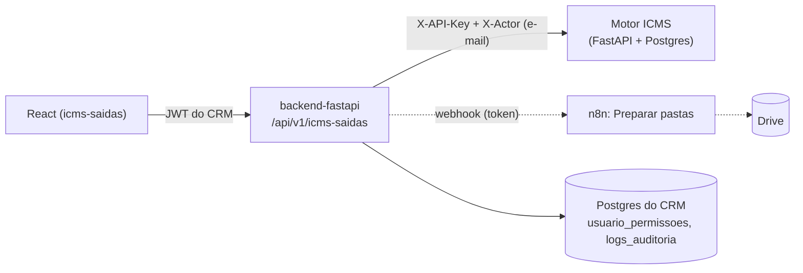

# ICMS Saídas

## 1. Identificação
- **Slug:** `icms-saidas` | **Status:** desenvolvimento (aguardando avaliação do fiscal) | **Criticidade:** alta
- **Setor responsável (dono técnico):** Fiscal / Núcleo Digital

## 2. Função do sistema
Transforma o relatório mensal de vendas de cada empresa em planilha de conferência de ICMS (Outros Débitos — OD — e Estornos de
Débito — ED), usando a **memória tributária da empresa** (tributação por produto, versionada por vigência) e as **regras fiscais**
do escritório (PE). A interface vive no CRM; o cálculo, a memória e as regras ficam no **motor**
(repositório `tnunes8/motor-calculos`), que continua rodando onde está e **só o backend do CRM chama**.
As regras fiscais são decisão do fiscal: ver `docs/01-regras-fiscais.md` no repositório do motor.

## 3. Setores que utilizam
Fiscal (card visível ao setor FISCAL; as ações dependem das permissões abaixo).

## 4. Stack utilizada
| Camada | Tecnologia | Versão | Observação |
|---|---|---|---|
| Frontend | React (módulo nativo em `frontend/src/systems/icms-saidas`) | 19 | CSS escopado em `.icms-root`, tokens mapeados para `--mg-*`; testes com vitest (`npm test`) |
| Backend | `backend-fastapi` — `app/api/v1/endpoints/icms_saidas.py` + `app/integrations/icms_saidas/` | — | proxy fechado (lista de rotas fixa), sem passthrough genérico |
| Motor | FastAPI + PostgreSQL (repo `tnunes8/motor-calculos`) | — | fora deste repositório; deploy próprio no Coolify |
| Banco do CRM | tabela `usuario_permissoes` (migração `e8b1c4a7d2f9`) | — | só as permissões; dados fiscais ficam no banco do motor |

## 5. Arquitetura

O navegador nunca fala com o motor nem conhece a chave dele. O backend acrescenta `X-API-Key` e `X-Actor` (e-mail de quem
agiu, que o motor grava na auditoria dele) e não repassa cabeçalhos nem cookies do cliente.

## 6. Banco de dados
`usuario_permissoes (usuario_id, permissao, granted_by, created_at)` — uma linha por permissão concedida. Ações que ALTERAM o
motor, concessões e revogações vão para `logs_auditoria` (nunca corpo, arquivo ou chave). A memória tributária, as apurações, as
pendências e as regras fiscais estão no banco do motor (ver `docs/03-modelo-de-dados.md` no repo do motor).

## 7. Autenticação e permissões
- **Método:** JWT do CRM (o mesmo de todos os sistemas).
- **RBAC por ação**, configurável por pessoa pelo ADMIN do CRM na tela **Permissões** do próprio sistema. ADMIN tem todas; qualquer
  permissão de ação inclui `consultar`. Backend confere em toda rota (o front só esconde botões).

| Permissão | O que libera |
|---|---|
| `icms_saidas.consultar` | ver painel, empresas, apurações, memória, lotes, pendências e regras |
| `icms_saidas.operar` | apurar/reprocessar, enviar/corrigir/completar a memória, resolver/descartar pendências, baixar planilhas |
| `icms_saidas.aprovar_lotes` | aprovar (item a item) ou rejeitar lotes de atualização da memória |
| `icms_saidas.gerir_empresas` | cadastrar/editar/ativar/desativar empresas e criar as pastas no Drive |
| `icms_saidas.editar_regras` | editar o rascunho, publicar e descartar as regras fiscais |

Sugestão de uso: o fiscal que opera recebe `operar`; o coordenador fiscal recebe também `aprovar_lotes`, `gerir_empresas` e
`editar_regras`. Empresas são um cadastro **próprio do módulo** (código gerado, razão social, CNPJ), sem vínculo com os clientes do CRM.

## 8. PWA
- **Perfil:** nao-aplicavel | **Manifest:** não | **Service worker:** não | **Offline:** nenhum

## 9. Integrações externas
- **Motor ICMS** (repo `tnunes8/motor-calculos`) — cálculo, memória tributária e regras fiscais.
- **n8n** — workflow "Motor ICMS – Preparar pastas" (cria as pastas das empresas no Drive; disparado ao cadastrar empresa e pelo
  botão "Criar pastas no Drive"; agrupado em no máximo 1 disparo por minuto; falha dele nunca derruba o cadastro). O varredor de
  pastas que envia relatórios ao motor (n8n → motor) continua falando direto com o motor, com a própria chave.

## 10. Dependências de outros sistemas internos
- `crm-mg` — autenticação, `logs_auditoria`, registro em `sistemas`.

## 11. Variáveis de ambiente
| Nome | Obrigatória | Sensível | Descrição |
|---|---|---|---|
| `MOTOR_ICMS_URL` | sim | não | URL base do motor (ex.: `http://motor-icms:8000` na rede interna do Coolify). Vazia ⇒ o sistema responde 503 `MOTOR_NAO_CONFIGURADO` |
| `MOTOR_ICMS_API_KEY` | sim | **sim** | chave do CRM no motor. No motor: `API_KEYS="...,crm:<chave>"` e `REGRAS_ADMIN_SISTEMAS="...,crm"` (sem isso ninguém publica regras) |
| `ICMS_N8N_URL_PASTAS` | não | não | webhook do workflow "Preparar pastas". As duas do n8n juntas ou nenhuma; vazias ⇒ botão responde 503 e o cadastro segue normal |
| `ICMS_N8N_TOKEN` | não | **sim** | token enviado no cabeçalho `X-Painel-Token` |

## 12. Observações de segurança e LGPD
- Dados fiscais de clientes do escritório (relatórios de vendas, memória tributária): acesso só autenticado e por permissão; arquivos
  enviados ficam no motor (`DATA_DIR`), nunca no CRM.
- Isolamento entre empresas é responsabilidade do motor (todo recurso filho é buscado com `empresa_id` dentro da query); o proxy do
  CRM valida o formato do código da empresa e dos ids e limita corpo (64 KB JSON) e uploads antes de repassar.
- A chave do motor e o token do n8n nunca vão para resposta, log ou auditoria (testes cobrem o vazamento).

## Implantação (ordem)
1. **Motor**: publicar a versão atual (branch `main` do `tnunes8/motor-calculos`; inclui a correção da leitura de CSV com aspas) e
   adicionar `crm:<chave>` em `API_KEYS` e `crm` em `REGRAS_ADMIN_SISTEMAS`.
2. **CRM backend**: definir `MOTOR_ICMS_URL`/`MOTOR_ICMS_API_KEY` (e as do n8n, se for usar) e subir; a migração `e8b1c4a7d2f9` cria
   `usuario_permissoes` (idempotente).
3. **Cadastro do sistema**: `psql "$DATABASE_URL_CRM" -f cadastro_icms_saidas.sql` (idempotente; não há tela para isso).
4. **Frontend do CRM**: build normal (`npm run build`); `npm test` roda os testes do módulo.
5. **Permissões**: o ADMIN abre o sistema → *Permissões* e concede ao pessoal do Fiscal.
6. Depois da conferência de paridade, desativar o painel provisório (`motor-icms-web`).

## Limitações conhecidas
- A cor de destaque do CRM (dourado) e o amarelo-âmbar de "pendência" são parecidos: pendência sempre aparece com texto e borda
  próprios, nunca só pela cor.
- Regras de lint `react-hooks/set-state-in-effect` e `react-refresh/only-export-components` estão desligadas só para este módulo
  (telas portadas e cobertas por testes); ver `frontend/eslint.config.js`.
